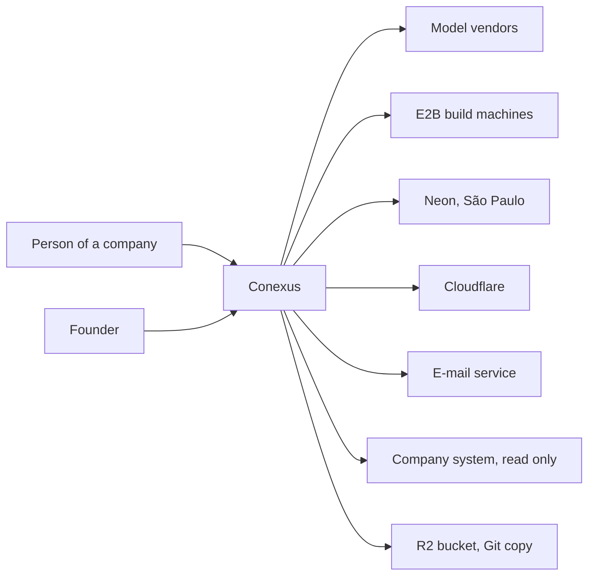
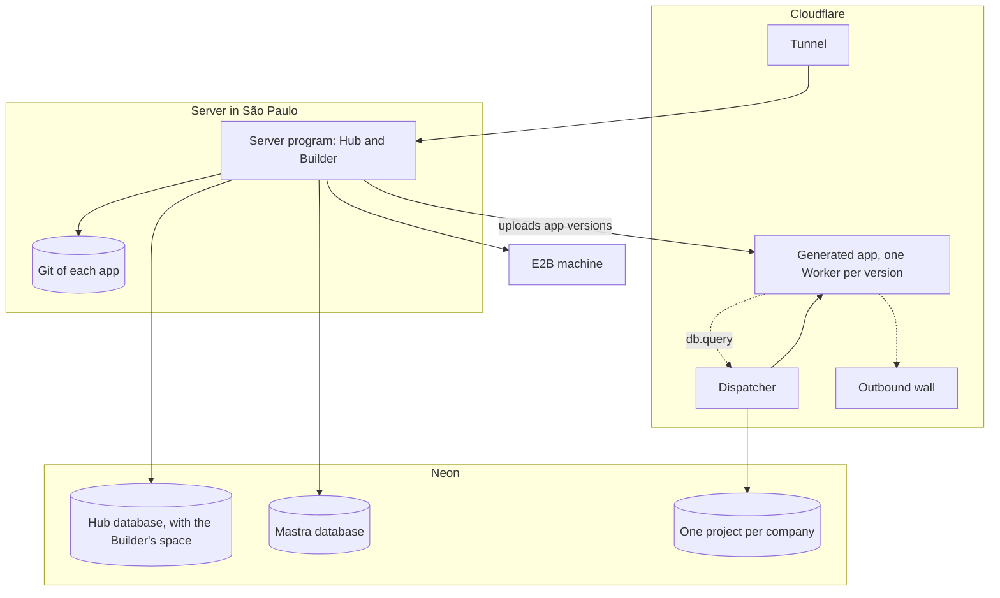

# Architecture

What Conexus is, its parts, where each runs and who owns what. A choice that is expensive to undo
has a record in [`decisions/`](decisions/), cited here as [0020]; the record holds the reason, the
founder's words and what reopens it. The rules that follow from this design live in the
[guides](guides/). The sections follow arc42, with C4 context and container levels.

## 1. Introduction and goals

A person in a company asks Conexus, in Portuguese, for a business app. An agent, the Builder,
writes it. The app runs for the people of that company, on that company's data. One founder
operates the whole installation, for a handful of invited companies at launch.

**Quality goals, in order.**

1. **Isolation.** A company never reads another company's rows. An app never reads another app's
   data. Generated code holds no secret and reaches no network.
2. **Recoverable by one person.** Every part can be published, rolled back and restored by the
   founder, without a terminal.
3. **Cheap at rest.** With nobody using it, Conexus leaves its databases asleep [0009].
4. **Native first.** A platform or library feature comes before Conexus code. Each exception names
   the line where the library does less.
5. **Readable.** One language, one tree, and walls checked by a machine, so one person and an agent
   can find the owner of any fact [0002] [0003].

**What the product never does.** It never invents a value or simulates progress: a figure shown as
coming from a system came from a real read, and an unknown is shown as unavailable, never as zero.
It never lets the model declare work done; Conexus owns the run's state. It never overwrites someone
else's newer work. It never shows a credential. It never publishes on its own. Conexus is not an ERP
replacement, a database console or a drag-and-drop tool: people create by conversation, the result
is real code, and the official data stays in the company's systems.

**Who has a stake.** The founder: product owner, operator, and the person who closes each step by
using it. Company administrators and members, who use the Hub and the apps. The agents that build
Conexus, which read [`AGENTS.md`](../AGENTS.md), the skills and the guides.

## 3. Context and scope



| Outside system | What crosses | Leaves Brazil |
| --- | --- | --- |
| Model vendors (Anthropic, OpenAI, Google) | The conversation with the Builder and the code it reads | Yes [0032] |
| E2B | The code under construction, while it is compiled and tested | Yes [0032] |
| Neon | Every row: the Hub's, the Builder's, Mastra's and each company's | No |
| Cloudflare | Each request to the Hub and to an app; the apps' code | Request path only |
| E-mail service | Invitation e-mails [0017] | Yes |
| Company system | Read-only queries through a connector [0031] | Depends on the company |
| R2 bucket | Each app's Git bundle [0051] | Request path only |

Each company is told in writing, before it enters, what leaves Brazil [0032].

## 5. Building blocks



| Container | Responsibility | Owns |
| --- | --- | --- |
| Server program | The Hub: screens' API, sign-in, companies, invitations, Projects, connectors, publishing. The Builder: the agent, conversations, runs, the build machine, the Git of each app, model accounts [0006] | Nothing on disk but the Git |
| Web | The Hub's screens, served by the server program | Nothing |
| Dispatcher | Checks the session, hands the app a `db` capability bound to that app's login, calls the app [0019] [0043] | The key app passwords derive from |
| Outbound wall | Refuses every network call from an app | Nothing |
| Generated app | One Worker per app version, with its screen files inside, no binding, no secret [0018] [0055] | Nothing |
| Hub database | Companies, people, sessions, Projects; the Builder's space holds runs and model accounts [0011] | Company column on every table [0012] |
| Mastra database | Mastra's own tables: threads, memory, traces, under a login of its own [0010] | Nothing of the Hub |
| Company project | One schema and two logins per app and environment: one runs the app, one applies its migrations [0021] | The company's app data |
| E2B machine | Compiles and tests the app the agent writes [0028] | Nothing after the run |

**The Hub and the Builder.** One program, two modules, with written boundaries [0006]. The Builder
calls the Hub through named ports: admit, read a connector, store an app version,
delete what belongs to a Project, a company or a person. A port may run inside the caller's
transaction, so creating a run and delivering the app stay one step. The Hub never imports the
Builder; `main.ts` wires both.

**The tree.** "Package" is a folder with its own `package.json`; "subject" is a folder holding one
product theme [0003].

```text
apps/
  server/              the program: Hub and Builder
    src/main.ts        the only file that wires both
    src/platform/      technique without a subject: config, database, error, log
    src/hub/           one folder per subject
    src/builder/       one folder per subject
    migrations/        generated by Drizzle
  web/                 the Hub's screens
  edge/                Cloudflare: dispatcher and outbound wall
packages/
  hub-api/             the shape of the Hub's routes
  app-contract/        the generated app's contract, versioned
docs/  scripts/  infra/  tests/e2e/  .agents/skills/  .github/
```

A subject holds its own routes, tables
and tests, and a `public.ts` with what others may use. The import law is
[code C3 to C8](guides/code.md); the web side's tree is [web W1](guides/web.md).

## 7. Deployment

| Where | What runs | Choice |
| --- | --- | --- |
| A rented server in São Paulo | The server program, from an image built by GitHub Actions and run with Compose, behind the Cloudflare Tunnel. The server opens no port | [0007] |
| Cloudflare | Tunnel, dispatcher, outbound wall, and a Workers for Platforms namespace for the apps, on a second domain, one host per app and environment | [0018] [0023] [0024] |
| Neon | Two organizations of Conexus's own: the Hub's, one project with two databases; the companies', one project each, under a key that cannot reach the Hub's | [0008] [0009] [0021] [0040] |
| E2B | Build machines behind a list of domains, under the founder's free-account key | [0028] [0051] |

**Publish.** A GitHub Release of a commit on `main` builds the image and puts it live, with no
command on the server; a merge alone publishes nothing [0035] [0044]. Migrations run before the
program starts ([data D9](guides/data.md)).

**Roll back.** One button restores an earlier release's image. Every migration only adds, so
an earlier image runs on the migrated database ([data D6](guides/data.md)). Exceptions: step 4.2's
P6 B deleted old test companies, unrecoverably; from v0.5.1 none before v0.5.0 runs [0039]. Step 14.2 drops `run_event` (D30), `builder.run`, `companies_with_runs()`, `hub_runs`: no image before its release runs. The edge goes back first.

**Restore.** Neon restores a branch to a moment: 6 hours on the free plan, 7 days on the
paid one. Both Hub databases return to one instant. It then sets every login password
again, invalidates sessions; the Hub's start recreates app logins, and missing
Workers from the built files it keeps [0043]. A company's project restores alone. Restoring is
rehearsed where each thing is created: Hub in step 2, the Git in step 13, a company and
its Workers in steps 7 and 9, everything together in step 22.

**The Hub reaches its database** by the direct address, because a long-lived server keeps connections. Basis: only tested so; the pooled address serves callers that do not.

**Down alerts.** Cloudflare's Tunnel health notification and a free external monitor of the health
route both e-mail the founder; the route skips the database, so a hung program is seen too
[0035].

## 8. Crosscutting concepts

**The data path of an app** [0045]. The capability, inside the dispatcher, picks that app's login
and talks to Neon's HTTP driver. `db.query(text, values)` runs one statement in a read-only
transaction, so PostgreSQL refuses a write; `db.batch` runs every write of a call in one transaction.
Nothing carries from one call to the next; the rule for apps is [data D28](guides/data.md). A
call's numbers are `APP_CALL_LIMITS` [0047]: the platform cuts its CPU at 50 ms (`cpu_ms` at the
version's upload, also set on each call) and its 51st `db` call (the call's `subRequests`, which
counts the capability's calls). Pieces still made by hand here:

| Piece | Why it remains | Basis |
| --- | --- | --- |
| Session check | No call reaches an app without it | Purpose |
| 10 s deadline per call | No platform limit cuts an app that only waits | Measured [0047] |
| Statement and transaction timeouts on the run login | A slow statement or batch keeps running after the caller gets the error | Measured [0047] |

**Who may enter** [0013] [0014] [0015] [0016]. The Hub's session has three guarantees: no stored
row works alone to sign in, the cookie is valid for one exact host, and the session has an idle and
a total deadline. Who holds it, and where companies, members and invitations live, are reopened
[0013] [0015]. Better Auth handles password, reset and the attempt limit. App sessions, the one-use
handoff to an app and the Preview session are Conexus's own. An app session lives inside the
Hub's, with no sign-out of its own [0041].

**Isolation, in layers.** Hub admission on every read and write, with the company column on every
table and the company carried in every transaction [0012]; row policies bound each transaction's
scope [0039].
One project per company and one login per app, so PostgreSQL refuses a cross read [0021]. An app
without secret or network [0018]. The rows Mastra writes carry the company, built by the server,
never by the browser.

**Model accounts and calls** [0049] [0050]. One queue per provider for the company and
each person; the credential is sealed with the installation key and opened only inside the
program, for one attempt, by Mastra's processors.

**Work that runs alone.** Scheduled jobs run on timers in the program, with a lease row naming the
copy of the program that owns them. Basis: implemented so; accepted because queues and Redis serve
a scale that does not exist. Every job is shaped to let the database sleep:

| Job | Shape that lets the database sleep |
| --- | --- |
| Run heartbeat and takeover | One pass at start, then only while a run is open |
| Expired sessions, handoffs, invitations | Expiry checked on read; cleanup once a day |
| Idle conversations, idle machines, traces | Touch nothing when there is nothing; daily otherwise |
| The lease | Renewed by activity, not by clock |

**Shutdown.** The program waits for live Builder turns to end before it exits; an update waits
with it.

## 11. Risks and technical debt

| Risk | What a person would see | Where it is handled |
| --- | --- | --- |
| Vendor terms forbid subscription sign-in inside a third-party service | A model account blocked, its owner suspended [0049] | Accepted; operators choose kinds |
| Two batches in one action | The second fails and the first stays [0047] | The Builder's skill, step 13 |
| The app login key leaks | Its holder enters every app's database [0043] | Rotation in the how-to |
| CPU limits act in seconds, with tolerance | Many looping apps at once slow others | Step 22 load test |
| The Hub's database never sleeps | The free allowance ends near day 17 and Neon suspends it [0009] | Step 2 test; back to the founder if it fails |
| Six hours of history on the free plan | A mistake seen the next day cannot be undone | Paid plan with the first company [0009] |
| The server stops | Hub and published apps stop [0025] | Revisited in step 18 |
| Betas: Cloudflare e-mail, Workers VPC, Mastra's agent controller, Drizzle 1.0 | An update breaks a path | Versions pinned; fallback named in each record |
| One E2B key for the founder's account | A release kills another's machine | It kills only this installation's machines [0051] |
| The publish runner runs as root on the server | Any writer of the repository can command the server [0035] | Accepted by the founder; forks never reach the runner |
| The runner registration token passes through one call's environment, not a file (S31) | A token readable by root for one call on the server | Accepted by the founder [0036] |
| The owner login's key, the app key and the Workers token rest on the server | Root there reads them and changes the edge | Accepted with the runner row [0035] |
| Transplanted code carries old decisions | A rule kept only because it existed | `conexus-study` [0001] |
| A page the Builder reads hides instructions | It strays, or leaks conversation text in an address | Accepted, founder 2026-10-19 [0050] |
| A company's Neon project outlives its company | Company data nobody sees | Phased deletion keeps the company until its project leaves [0040] |

**Debt.** Small fixes left on a brought part are listed here, one line each, with the step that
removes them.

- Until the first scheduled job, expired `auth.session` and `auth.verification` rows leave only
  when presented; expired app handoffs, and a deleted Projeto's, only with their Hub session.
- `projects.project.host_label` stays nullable: a rolled-back 7.x Projeto has none.
- `createUser`, `listUsers` and `findCredentialAccount` are internal library calls, with no
  public one while sign-up is closed: the version stays pinned (step 3, criteria 21 and 22).
- Trace ids are Fastify's request ids until 21.1 [0052].
- A conversation created between a release and its removal leaves an orphan thread (16).
- The database calls carry no cancel signal (C57): `pg@8.23.1` accepts none, so deadlines end waits.
