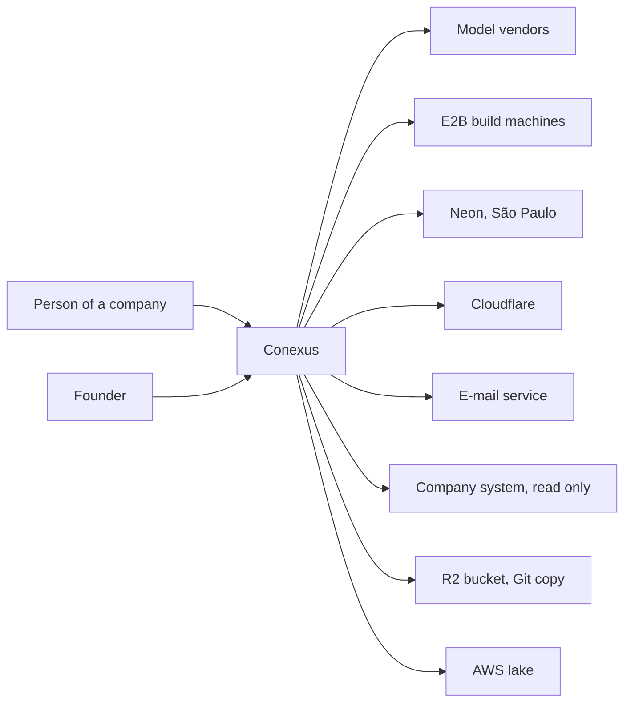
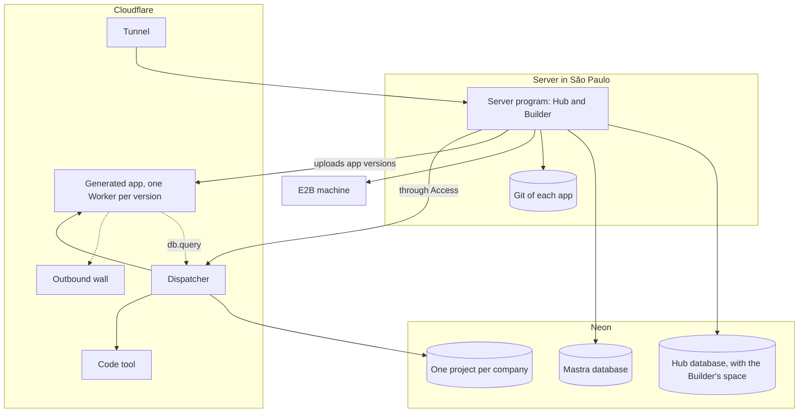

# Architecture

What Conexus is, its parts, where each runs and who owns what. A costly choice has a record in
[`decisions/`](decisions/), cited as [0020], with its reason, the founder's words and what reopens
it. The rules live in the [guides](guides/).

## 1. Introduction and goals

Conexus gathers company data, systems and know-how in a context and ontology layer that learns.
On it the company analyses, automates, uses AI and asks for apps; the Builder agent writes them, for
its people, on its data. One founder operates it, for a handful of invited companies
at launch.

**Quality goals, in order.**

1. **Isolation.** A company never reads another company's rows. An app never reads another app's
   data. Generated code holds no secret and reaches no network.
2. **Recoverable by one person.** Every part can be published, rolled back and restored by the
   founder, without a terminal.
3. **Cheap at rest.** Idle, Conexus leaves its databases asleep [0009], the Hub's woken only at
   automation fires (data D27).
4. **Native first.** A platform or library feature comes before Conexus code. Each exception names
   the line where the library does less.
5. **Readable.** One language, one tree, and walls checked by a machine, so a person or an agent
   finds any fact's owner [0002] [0003].

**What the product never does** is [`VISION.md`](../VISION.md), in Portuguese.

**Who has a stake.** The founder: product owner, operator, and the person who closes each step by
using it. Company administrators and members, who use the Hub and apps. The agents that build
Conexus, which read [`AGENTS.md`](../AGENTS.md), the skills and the guides.

## 3. Context and scope



| Outside system | What crosses | Leaves Brazil |
| --- | --- | --- |
| Model vendors (Anthropic, OpenAI, Google) | The conversation with the Builder or the Assistant, and what it reads | Yes |
| E2B | The code under construction; the rows the Assistant analyses, while its conversation exists | Yes |
| Neon | Every row outside the lake: the Hub's, the Builder's, Mastra's and each company's | No |
| AWS | Each company's copied rows [0070] | Yes |
| Cloudflare | Each request to the Hub and to an app; the apps' code | Request path only |
| E-mail service | Invitation and automation e-mails [0017] | Yes |
| Company system | Read-only queries through a connector [0056] | Depends on the company |
| R2 bucket | Each app's Git bundle [0051] | Request path only |

## 5. Building blocks



| Container | Responsibility | Owns |
| --- | --- | --- |
| Server program | The Hub: screens' API, sign-in, companies, invitations, Projects, connectors, publishing. The Builder: the agent, the Assistant, its automations, conversations, runs, the machines, the Git of each app, model accounts [0006] | Nothing on disk but the Git |
| Web | The Hub's screens, served by the server program | Nothing |
| Dispatcher | Checks the session, hands the app a `db` capability bound to that app's login, calls the app or a code tool [0019] [0043] | The key app passwords derive from |
| Outbound wall | Refuses every network call from an app | Nothing |
| Generated app, code tool | One Worker per app version, with its screen files, or tool version, reading only what it declares; no binding or secret [0018] [0055] | Nothing |
| Hub database | Companies, people, sessions, Projects; the Builder's space holds runs and model accounts [0011] | Company column on every table [0012] |
| Mastra database | Mastra's own tables: threads, memory, traces, under a login of its own [0010] | Nothing of the Hub |
| Company project | One schema per Project, Prévia and published app alike; run, migration and read logins [0021] | The company's app data |
| E2B machine | Compiles and tests the app; runs Assistant and agent code [0028] [0059] | Nothing after the conversation |

**The Hub and the Builder.** One program, two modules, written boundaries [0006]. The Builder
calls the Hub through named ports: admit, read a connector, store an app version,
delete what belongs to a Project, a company or a person. A port may run inside the caller's
transaction, so a run and its delivery stay one step. The Hub never imports the
Builder; `main.ts` and `conversations-of.ts` wire both, and `reseal.ts` runs after each deploy's migrations.

**The tree.** "Package" is a folder with its own `package.json`; "subject" is a folder holding one
product theme [0003].

```text
apps/
  server/              the program: Hub and Builder
    src/main.ts        wires both
    src/platform/      technique without a subject: config, database, error, log
    src/hub/           one folder per subject
    src/builder/       one folder per subject
    migrations/        generated by Drizzle
  web/                 the Hub's screens
  edge/                Cloudflare: dispatcher and outbound wall
packages/
  hub-api/             the shape of the Hub's routes
  app-contract/        the generated app's contract, versioned
  app/                 what the Builder writes an app with
  connectors/          the connector kit
docs/  scripts/  infra/  tests/e2e/  .agents/skills/  .github/
```

A subject holds its own routes, tables
and tests, and a `public.ts` with what others may use. The import law is
[code C3 to C8](guides/code.md); the web side's tree is [web W1](guides/web.md). A new one follows
[adding a subject](how-to/add-a-subject.md).

**Other subjects.** `hub/copies` keeps only `routes.test.ts`, the guard that the old copy routes answer 404;
the tables left with G0c ([the Sync](explanation/sync.md)); the lake takes the copies [0070].
`hub/ontology` has only tables and a contract. `hub/notifications` sends bell and e-mails,
`hub/operations` keeps the Central's clients, `hub/status` each start's version. `builder/app-data`
reads an app's data for the Builder and for the agents of `builder/agents`;
`builder/construtor` edits an agent's draft ([agents](explanation/agents-and-automations.md)).
`builder/mastra` builds the `Mastra` and prunes its traces daily. The Hub image carries CLIProxyAPI,
the Google sign-in binary [0049]. Packages: [app](explanation/app-package.md),
[connectors](how-to/add-a-connector.md).

## 7. Deployment

| Where | What runs | Choice |
| --- | --- | --- |
| A rented server in São Paulo | The server program, from an image built by GitHub Actions and run with Compose, behind the Cloudflare Tunnel. The server opens no port | [0007] |
| Cloudflare | Tunnel, dispatcher, outbound wall, and a Workers for Platforms namespace for the apps, on a second domain, one host per app | [0018] [0023] [0024] |
| Neon | Two organizations of Conexus's own: the Hub's, one project with two databases; the companies', one project each, under a key that cannot reach the Hub's | [0008] [0009] [0021] [0040] |
| E2B | Build, Assistant and agent machines behind a domain list, under the founder's free-account key | [0028] [0051] [0059] |
| AWS, a lab account for now [0072] | The lakes, read by the agents [0079]; Fargate copy tasks; the Hub's stack per company; the CDK platform | [0070] [0073] [0075] [0076] |

**Publish.** Merging a release note tags `main`, builds the image and puts it live with no command
on the server; no other merge publishes [0035] [0044] [0081]. Migrations run before the
program starts ([data D9](guides/data.md)).

**Roll back.** One button restores an earlier release's image; migrations only add, so it runs on
the migrated database ([data D6](guides/data.md)). No image runs from
before v0.5.0 (old test companies deleted [0039]), 14.2 (`run_event` (D30), `builder.run`,
`companies_with_runs()`, `hub_runs`), v0.24.101 (`copies.copy.readers_set`) or the closing of A
Prévia em endereço próprio (`apps.app_session.environment`, `apps.handoff.environment`) or v0.24.119,
the G0b (the nine tables of the `copies` schema and the schema itself, `notifications.copy_follower`
and `copy_notice`): each drops what older images use. The edge goes back first. Past v0.24.53, rerun
`20261108033751_e245_active_by`'s `UPDATE`.

**Restore.** Neon restores a branch to a moment: 6 hours on the free plan, 7 days on the
paid. Both Hub databases return to one instant, every login password is set again and sessions are
invalidated; the Hub's start recreates app logins and missing Workers from the built files it keeps
[0043]. A company's project restores alone.

**The Hub reaches its database** by the direct address, since a long-lived server keeps connections. Basis: only tested so.

**Down alerts.** The Tunnel's health notification and an external monitor of the health route
e-mail the founder; the route skips the database, so a hung program shows [0035].

## 8. Crosscutting concepts

**The data path of an app** [0045]. The capability, inside the dispatcher, picks that app's login
and talks to Neon's HTTP driver: `db.query` in a read-only transaction, `db.batch` in one
transaction for a call's writes. Nothing carries between calls ([data D28](guides/data.md)). The
limits are `APP_CALL_LIMITS` [0047], listed in [the contract and the dispatcher](explanation/app-contract-and-dispatcher.md).
Made by hand: the session check, as no call may reach an app without it (purpose); the 10 s call
deadline and the run login's statement and transaction timeouts, as no platform limit cuts a
waiting app and a slow statement outlives the caller's error (measured [0047]).

**Who may enter** [0013] [0014] [0015] [0016]. The Hub's session has three guarantees: no stored
row works alone to sign in, the cookie is valid for one exact host, and the session has an idle and
a total deadline. Who holds it, and where companies, members and invitations live, are reopened
[0013] [0015]. Better Auth handles password, reset and the attempt limit. App sessions and the
one-use handoff to an app (`/apps/open`, or `createAppFrameHandoff` in the Prévia's frame) are
Conexus's own; an app session lives inside the Hub's, with no sign-out of its own [0041].

**Isolation, in layers.** Hub admission on every read and write, the company column on every
table and the company carried in every transaction [0012]; row policies bound each transaction's
scope [0039]. One project per company and one login per app, so PostgreSQL refuses a cross read
[0021]. An app without secret or network [0018]. The rows Mastra writes carry the company, built by
the server, never by the browser. In the lake, a bucket and reader role per company; only the Hub
queries Athena, under grants its marks derive [0078].

**Model accounts and calls** [0049] [0050]. One queue per provider for the company and
each person; the credential is sealed with the installation key and opened only inside the
program, for one attempt, by Mastra's processors.

**Work that runs alone.** Scheduled work is rows of Mastra's `mastra.schedules`: automations, the
Sync's copies and the daily trace prune. A single owner follows [data D25](guides/data.md), as in a
copy's run and a model account's refresh. Basis: implemented so; Redis serves
a scale that does not exist. Lake copies end by a queue, with no lease [0076]. Sessions,
handoffs and invitations are expired on read; the scheduler sleeps between fires ([data D27](guides/data.md)).

No job touches a machine; it ends with its conversation.

**Shutdown.** The program waits for live Builder turns before exiting; an update waits
too.

## 11. Risks and technical debt

| Risk | What a person would see | Where it is handled |
| --- | --- | --- |
| Vendor terms forbid subscription sign-in inside a third-party service | A model account blocked, its owner suspended [0049] | Accepted; operators choose kinds |
| Two batches in one action | The second fails and the first stays [0047] | The Builder's skill, step 13 |
| The app login key leaks | Its holder enters every app's database [0043] | Rotation in the how-to |
| CPU limits act in seconds, with tolerance | Many looping apps at once slow others | Step 22 load test |
| The Hub's database never sleeps | The free allowance ends near day 17 and Neon suspends it [0009] | Step 2 test; if it fails, the founder |
| Six hours of history on the free plan | A mistake seen the next day cannot be undone | Paid plan with the first company [0009] |
| The server stops | Hub and published apps stop [0025] | Kept: the check stays in the Hub (step 18, `G`) |
| Betas: Cloudflare e-mail, Workers VPC, Mastra's agent controller, Drizzle 1.0 | An update breaks a path | Pinned; each record names a fallback |
| One E2B key for the founder's account | A release kills another's machine | It kills only this installation's [0051] |
| The publish runner runs as root; its token and keys rest on the server (S31) | A repository writer, or root there, commands server and edge [0035] [0036] | Accepted by the founder; forks never reach it |
| Transplanted code carries old decisions | A rule kept just for existing | `conexus-study` [0001] |
| A page the Builder reads hides instructions | It strays, or leaks conversation text in an address | Accepted, founder 2026-10-19 [0050] |
| A company's Neon project outlives its company | Company data nobody sees | Phased deletion keeps the company until its project leaves [0040] |
| The lab AWS account | When credits end it closes with its data [0072] | The official account, before another company |

**Debt.** Fixes left, and what removes them.

- Until the first scheduled job, expired `auth.session`, `auth.verification` and app-handoff rows
  leave only when presented.
- `projects.project.host_label` stays nullable (a rolled-back 7.x Projeto).
- `createUser`, `listUsers` and `findCredentialAccount` are internal calls while sign-up is closed:
  the version stays pinned (step 3).
- Trace ids are Fastify's request ids until 21.1 [0068].
- A conversation created between a release and its removal leaves an orphan thread (16).
- Database calls cannot be cancelled (C57, `pg@8.23.1`): deadlines end waits.
- A refresh lost after the key turned, or 6 idle months, forces a reconnect. Trigger: `CONNECTION_REFRESH_UNANSWERED` then `NEEDS_REAUTH`.
- Mercado Livre's page shapes are unmeasured. Trigger: a failed read on a real account.
- No unit yet drops `connection.last_test` (D6).
- Only a failed lake's bucket is checked, and the 100-lake quota has no message. Triggers: another
  orphan; 80 lakes.
