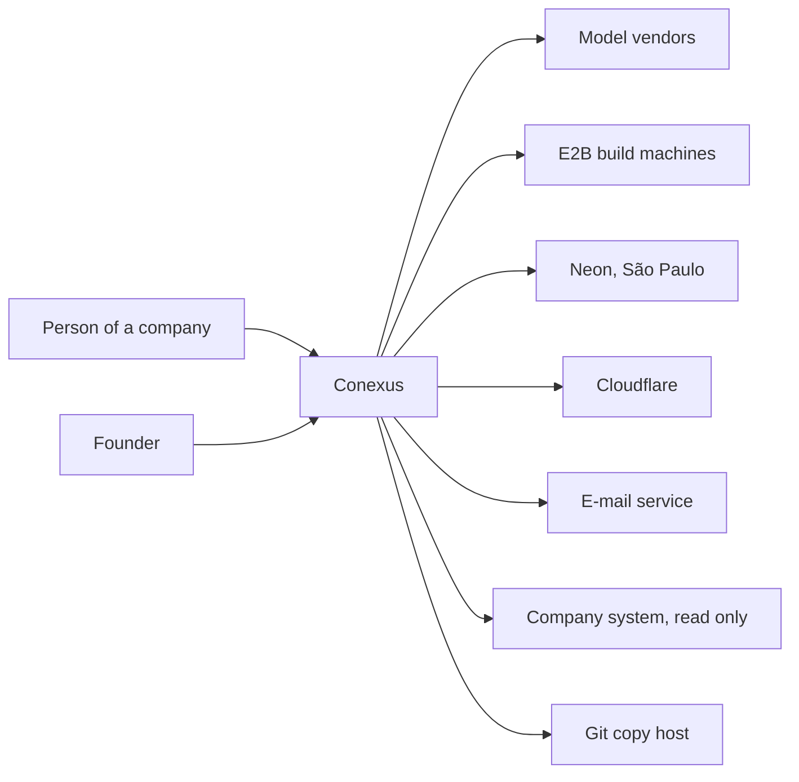
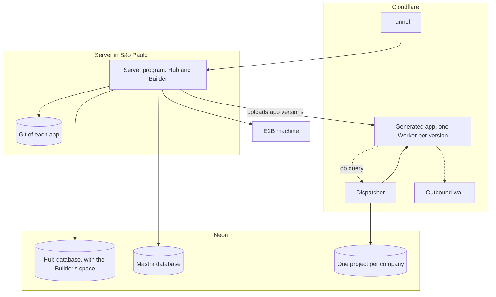

# Architecture

What Conexus is, its parts, where each runs and who owns what. It states what is decided. A choice
that is expensive to undo has a record in [`decisions/`](decisions/), cited here as [0020]; the
record holds the reason, the founder's words and what reopens it. The evidence behind the records
lives outside this repository. The rules that follow from this design live in the
[guides](guides/). The sections follow arc42 (1, 3, 5, 7, 8 and 11), with the C4 context and
container levels.

Step numbers are the steps of the [roadmap](roadmap.md).

## 1. Introduction and goals

A person in a company asks Conexus, in Portuguese, for a business app. An agent, the Builder,
writes it. The app runs for the people of that company, on that company's data. One founder
operates the whole installation, for a handful of invited companies at launch.

**Quality goals, in order.**

1. **Isolation.** A company never reads another company's rows. An app never reads another app's
   data. Generated code holds no secret and reaches no network.
2. **Recoverable by one person.** Every part can be published, rolled back and restored by the
   founder, without a terminal. Restoring is rehearsed in the step that creates each part.
3. **Cheap at rest.** With nobody using it, Conexus leaves its databases asleep [0009].
4. **Native first.** A platform or library feature comes before Conexus code. Each exception names
   the line where the library does less.
5. **Readable.** One language, one tree, and walls checked by a machine, so one person and an agent
   can find the owner of any fact [0002] [0003].

**What the product never does.** It never invents a value or simulates progress: a figure shown as
coming from a system came from a real read, and an unknown is shown as unavailable, never as zero.
It never lets the model declare work done; Conexus owns the run's state. It never overwrites someone
else's newer work. It never shows a credential. It never publishes on its own. Conexus is not an ERP
replacement, a database console or a drag-and-drop tool: people create by conversation, the result
is real code, and the official data stays in the company's systems.

**Who has a stake.** The founder: product owner, operator, and the person who closes each step by
using it. Company administrators and members, who use the Hub and the apps. The agents that build
Conexus, which read [`AGENTS.md`](../AGENTS.md), the skills and the guides.

## 3. Context and scope



| Outside system | What crosses | Leaves Brazil |
| --- | --- | --- |
| Model vendors (Anthropic, OpenAI, Google) | The conversation with the Builder and the code it reads | Yes [0032] |
| E2B | The code under construction, while it is compiled and tested | Yes [0032] |
| Neon | Every row: the Hub's, the Builder's, Mastra's and each company's | No |
| Cloudflare | Each request to the Hub and to an app; the apps' code | Request path only |
| E-mail service | Invitation e-mails [0017] | Yes |
| Company system | Read-only queries through a connector [0031] | Depends on the company |
| Git copy host | A copy of each app's repository | To be chosen, step 13 |

Each company is told in writing, before it enters, what leaves Brazil [0032].

## 5. Building blocks



| Container | Responsibility | Owns |
| --- | --- | --- |
| Server program | The Hub: screens' API, sign-in, companies, invitations, Projects, connectors, publishing. The Builder: the agent, conversations, runs, the build machine, the Git of each app, model accounts [0006] | Nothing on disk but the Git |
| Web | The Hub's screens, served by the server program | Nothing |
| Dispatcher | Checks the session, hands the app a `db` capability bound to that app's login, calls the app [0019] [0022] | One secret per app login |
| Outbound wall | Refuses every network call from an app | Nothing |
| Generated app | One Worker per app version, with its screen files inside, no binding and no secret [0018] | Nothing |
| Hub database | Companies, people, sessions, Projects; the Builder's space holds runs and model accounts [0011] | Company column on every table [0012] |
| Mastra database | Mastra's own tables: threads, memory, traces, under a login of its own [0010] | Nothing of the Hub |
| Company project | One schema and two logins per app and environment: one runs the app, one applies its migrations [0021] | The company's app data |
| E2B machine | Compiles and tests the app the agent writes [0028] | Nothing after the run |

**The Hub and the Builder.** One program, two modules, with written boundaries [0006]. The Builder
owns the agent, conversations, runs, the build machine, the Git and model accounts; the Hub owns the
rest. The Builder calls the Hub through named ports: admit, read a connector, store an app version,
delete what belongs to a Project, a company or a person. A port may run inside the caller's
transaction, so creating a run and delivering the app stay one step. The Hub never imports the
Builder; `main.ts` wires both.

**The tree.** "Package" is a folder with its own `package.json`; "subject" is a folder holding one
product theme [0003].

```text
apps/
  server/              the program: Hub and Builder
    src/main.ts        the only file that wires both
    src/platform/      technique without a subject: config, database, error, log
    src/hub/           one folder per subject
    src/builder/       one folder per subject
    migrations/        generated by Drizzle
  web/                 the Hub's screens
  edge/                Cloudflare: dispatcher and outbound wall
packages/
  hub-api/             the shape of the Hub's routes
  app-contract/        the generated app's contract, versioned
docs/  scripts/  infra/  tests/e2e/  .agents/skills/  .github/
```

Subject names are fixed in the step that brings each one. A subject holds its own routes, tables
and tests, and a `public.ts` with what others may use. The import law is
[code C3 to C8](guides/code.md); the web side's tree is [web W1](guides/web.md).

## 7. Deployment

| Where | What runs | Choice |
| --- | --- | --- |
| A rented server in São Paulo | The server program, from an image built by GitHub Actions and run with Compose, behind the Cloudflare Tunnel. The server opens no port | [0007] |
| Cloudflare | Tunnel, dispatcher, outbound wall, and a Workers for Platforms namespace for the apps, on a second domain, one host per app and environment | [0018] [0023] [0024] |
| Neon | An organization of Conexus's own. One project for the Hub, with two databases; one project per company | [0008] [0009] [0021] |
| E2B | Build machines, under a key used by this installation only | [0028] |

**Publish.** A merge into `main` builds the image and puts it live, with no command on the server.
Migrations run before the program starts ([data D9](guides/data.md)).

**Roll back.** The previous image comes back with one button. Every migration only adds, so the
previous image runs on the migrated database ([data D6](guides/data.md)). A Worker rolls back with
Cloudflare's own versions.

**Restore.** Neon restores a branch to a moment: 6 hours back on the free plan, up to 7 days on the
paid one. Both Hub databases return to the same instant. A restore then sets every login password
again, invalidates sessions, rewrites the dispatcher's secrets and recreates every Worker from the
built files the Hub keeps for each app version. A company's project restores alone. Restoring is
rehearsed in the step that creates each thing: the Hub in step 2, the Git in step 13, a company and
its Workers in steps 7 and 9, everything together in step 22.

**The Hub reaches its database** by the direct address, because a long-lived server keeps its own
connections. Basis: only tested so; accepted because the pooled address serves callers that do not.

**Down alerts.** Cloudflare's Tunnel health notification, plus a health route that does not touch
the database, so a hung program is seen too.

## 8. Crosscutting concepts

**The data path of an app** [0020]. The app calls `db.query(text, values)`. The capability, inside
the dispatcher, reads the statement text, counts queries, picks that app's login and sends one
statement over Neon's HTTP driver; Neon runs it as one transaction. `db.batch` sends several
statements as one transaction, for all-or-nothing writes. Nothing carries from one query to the
next; the rule for apps is [data D28](guides/data.md). Pieces still made by hand on this path, each with its basis:

| Piece | Why it remains | Basis |
| --- | --- | --- |
| Session check | No call reaches an app without it | Purpose |
| Statement text reading | Refuses a login changing its own password and anonymous code blocks | Purpose |
| 5 s deadline per call | No platform limit cuts an app that only waits | The number: implemented so, revisited in step 10 |
| 50 queries per call | Platform limits do not count capability calls | The number: only tested so, revisited in step 10 |
| Statement timeout on each app login | A slow statement keeps running after the caller gets the error | Purpose |

**Who may enter** [0013] [0014] [0015] [0016]. The Hub's session has three guarantees: no stored
row works alone to sign in, the cookie is valid for one exact host, and the session has an idle and
a total deadline. Who holds it, and where companies, members and invitations live, are reopened
[0013] [0015]. Better Auth handles password, reset and the attempt limit. App sessions, the one-use
handoff to an app and the Preview session are Conexus's own. Where an app's session check lives is
chosen in step 18 by test.

**Isolation, in layers.** Hub admission on every read and write, with the company column on every
table and the company carried in every transaction; the row policy is decided in step 5 [0012].
One project per company and one login per app, so PostgreSQL refuses a cross read [0021]. An app
without secret or network [0018]. The rows Mastra writes carry the company, built by the server,
never by the browser.

**Model accounts** [0030]. The credential is sealed in the Builder's space and opened only inside
the program. In a conversation the person's account comes before the company's ([security
S34](guides/security.md)).

**Work that runs alone.** Scheduled jobs run on timers in the program, with a lease row naming the
copy of the program that owns them. Basis: implemented so; accepted because queues and Redis serve
a scale that does not exist. Every job is shaped to let the database sleep:

| Job | Shape that lets the database sleep |
| --- | --- |
| Run heartbeat and takeover | One pass at start, then only while a run is open |
| Expired sessions, handoffs, invitations | Expiry checked on read; cleanup once a day |
| Idle conversations, idle machines, traces | Touch nothing when there is nothing; daily otherwise |
| The lease | Renewed by activity, not by clock |

**Shutdown.** The program waits for live Builder turns to end before it exits; an update waits
with it. This wait is Conexus code.

## 11. Risks and technical debt

| Risk | What a person would see | Where it is handled |
| --- | --- | --- |
| Vendor terms forbid subscription sign-in inside a third-party service | A model account blocked without notice [0030] | Accepted by the founder |
| The verifier misses two separate writes built at runtime | An action left half done [0020] | Step 10 |
| The dispatcher holds 128 secrets | Near 100 app logins, no new app can be created [0022] | One dispatcher per company, built when the count nears it |
| CPU limits act in seconds, with tolerance | Many looping apps at once slow others | Step 22 load test |
| The Hub's database never sleeps | The free allowance ends near day 17 and Neon suspends it [0009] | Step 2 test; back to the founder if it fails |
| Six hours of history on the free plan | A mistake seen the next day cannot be undone | Paid plan with the first company [0009] |
| The server stops | Hub and published apps stop [0025] | Revisited in step 18 |
| Betas: Cloudflare e-mail, Workers VPC, Mastra's agent controller, Drizzle 1.0 | An update breaks a path | Versions pinned; fallback named in each record |
| One E2B key | A cleanup in another installation deletes a machine | A key of this installation only [0028] |
| Transplanted code carries old decisions | A rule kept only because it existed | `conexus-study` [0001] |

**Debt.** Small fixes left on a brought part are listed here, one line each, with the step that
removes them. None yet.
