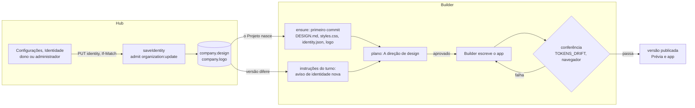

# Apps com identidade

Trilho: apps

Trilha Agentes e Apps, marco `A2` do [roteiro](../roadmap.md) (a Capacidade 5 da
[página da trilha](trilhas/agentes-e-apps.md), mais a direção de design de cada app). A ordem é a do
fundador em 2026-11-22: depois da etapa 2 do harness ("Uma sala e os nomes certos") e antes do `A3`.
Este cartão espera, num pull request em rascunho (delivery L5), o fechamento da etapa 2.

Lido em `main` `fb371462` (2026-11-24, depois do pull request 1358, o G5 da etapa 2). O pull request
1360, aberto, move `apps/server/src/builder/` para `apps/server/src/agents/` (o G5f): onde este
cartão diz `builder/conversation/`, o builder lê o caminho que a etapa 2 deixar. Versões lidas:
`better-auth` 1.7.8, `@mastra/core` 1.83.0, `recharts` do starter, o formato DESIGN.md do
[guia de design](../guides/design.md) e a skill Impeccable instalada na máquina.

## A página do fundador

**No fim desta etapa** você abre a identidade da empresa nas configurações, escolhe cores, fonte e
cantos e vê na hora uma tela de app com elas, clara e escura. Em duas empresas de teste com
identidades diferentes, pede ao Builder o mesmo app. Antes de construir, cada plano mostra a direção
de design daquele app. Os dois apps saem com `styles.css` diferentes, e você os distingue em
capturas lado a lado. Dois apps da mesma empresa saem com a mesma base e cada um com a sua direção.

**O roteiro de uso.**

1. Na empresa de teste A, como dono, abre Configurações, Identidade. Escolhe a cor de destaque, o
   tom dos neutros, a fonte e os cantos. A prévia ao lado muda na hora, em claro e escuro, com um
   gráfico cujas cores saem da identidade. Salva.
2. Na empresa de teste B, faz uma identidade bem diferente e salva.
3. Em cada empresa, pede ao Builder o mesmo app: "um acompanhamento de vendedores, com metas e
   clientes". O plano de cada um traz a seção "A direção de design": a identidade usada, a frase da
   direção, a densidade, a cor de destaque e as cores dos gráficos.
4. Aprova os dois planos. Abre as duas Prévias lado a lado e distingue qual é de qual empresa.
5. Num dos apps, pede "troca a cor de destaque para verde". Só aquele app muda; o outro app da mesma
   empresa continua com o destaque da identidade.
6. Entra como desenvolvedor da empresa A e abre a identidade: vê, mas não salva.

**O que você faz, e quando.** Antes: nada novo; as duas empresas de teste já existem. No começo:
aprova esta página e o protótipo da tela de identidade. No fim: faz o roteiro na nuvem, diz o que viu
e aprova os textos das telas.

**A visão.** "O app tem a cara da empresa, e os apps da mesma empresa parecem da mesma casa" (Conexus
Apps). "O plano vem antes do código" e "diz antes o que vai fazer" (Conexus Apps e Escopo). "Um modelo
pronto de app [...] é só um ponto de partida que cada empresa adapta" (Conexus Apps). "Mantém cada
empresa e cada app no seu lugar" (Escopo): a identidade de uma empresa nunca entra no app de outra.
"Publica um app sem o contrato e a conferência do Builder" é recusa (Escopo), e por isso a identidade
entra no código do app e passa pela conferência, nunca por fora dela.

**Fica de fora.**

- Gerar a identidade a partir do site da empresa (o open-lovable e o dyad fazem por app): pede uma
  chamada a um serviço de fora; fica para um cartão que a peça.
- Mudar a identidade de apps já publicados sem uma versão nova (decisão A).
- Várias identidades por empresa (marcas, filiais): nenhuma referência lida faz, e nenhum pedido seu.
- O Hub com a cara de cada empresa: o Hub segue a Pauta (`DESIGN.md` da raiz).
- Fontes de fora do app: a política do app só aceita a própria origem; a fonte vai empacotada no app.

**As decisões suas nesta etapa.** Respondidas em 2026-11-24, no quadro do estudo: "Todas decisoes recomendadas", ou seja, A.1, B.2, C.1 e D.1. As palavras vão para o arquivo de aprovação quando você aprovar esta página. O fundador pediu, em 2026-11-24, que as respostas de 2026-11-09
fossem ponto de partida, não trava. Onde a melhor forma diverge delas, a decisão diz o que mudou.

- **A. Quando a identidade muda, o que acontece com os apps que já existem?**
  - **A.1 (recomendo).** O app guarda a identidade com que nasceu. Na próxima conversa sobre ele, o
    Builder avisa que a identidade da empresa mudou e põe a atualização no plano; ela sai numa versão
    nova, conferida. Veredito: nativo (o app é código; a identidade entra como arquivo dele). É o que
    as referências fazem: o tema entra no app quando ele nasce (Appsmith; Base44 e v0 documentados).
  - **A.2.** Todo app muda na hora, sem versão nova, pela plataforma. Nenhuma referência lida faz, e
    passa por fora da conferência (recusa da visão).
  - O que mudou desde 2026-11-09 ("o app a segue"): o `A1` pôs a conferência entre o código e a
    publicação; seguir sem versão nova pularia essa conferência. A.1 é "o app segue" na próxima versão.
- **B. Até onde vai a direção de cada app?**
  - **B.1.** Só a cor de destaque muda por app, e só quando você pede (a resposta de 2026-11-09).
  - **B.2 (recomendo).** O plano de cada app escolhe a direção dentro da identidade: densidade, onde
    o destaque aparece, a ênfase das telas e, se você pedir, outro destaque. Fonte, neutros e cantos
    vêm da empresa; um app só sai deles se você pedir, e o plano diz que aquele app sai da identidade, porque o estilo é ponto de partida editável (sua palavra no estudo de formatos). Veredito: nativo (uma seção do plano em texto). Dyad e vibesdk põem a
    direção e a cor no plano de cada app; a sua decisão "3B" de 2026-11-14 diz "identidade da empresa
    mais direção por app".
- **C. O logotipo da empresa entra agora?**
  - **C.1 (recomendo).** Entra: o dono sobe um SVG ou PNG pequeno na identidade, e o app nasce com
    ele no topo. É o sinal mais claro de "mesma casa". O Better Auth já tem o campo `logo` na empresa,
    e o Dify troca o logotipo de todos os apps de um workspace. Custa uns 300 linhas.
  - **C.2.** Fica para depois; a identidade desta etapa é cor, fonte e forma.
- **D. Uma empresa sem identidade: como nasce o app dela?**
  - **D.1 (recomendo).** Com a identidade neutra de hoje, e a tela de identidade avisa o dono e o
    administrador. O plano diz "a empresa ainda não tem identidade; usei a padrão".
  - **D.2.** O Builder pede a identidade antes do primeiro app e espera.

## Como vai ser feito

Esta seção mostra a etapa pronta, com exemplos reais. Os arquivos de exemplo saíram de um protótipo
do gerador e da conferência, rodado sobre o `main` `fb371462`. Ele não está no repositório; as
unidades U1 e U3 escrevem a versão de verdade. O que o protótipo provou:

- A identidade padrão gera o `styles.css` de hoje byte a byte.
- As duas empresas de teste passam na conta de contraste e geram `styles.css` diferentes.
- O desvio de exemplo é pego (o item 4).
- **Achado.** No starter de hoje, o texto branco sobre o dourado tem contraste de 3,73:1, abaixo de
  4,5:1. A identidade padrão fica como está (critério 10), e o defeito vai para uma issue.

### 1. O registro: o DESIGN.md da empresa

Uma empresa guarda um DESIGN.md, no formato que o Impeccable lê e a Pauta do Hub usa. O frontmatter
traz os tokens, e são eles que valem. O texto embaixo explica o uso. As chaves de cor são os nomes de
variável do starter (`packages/app/starter/src/styles.css:8-44`), e o modo escuro usa o prefixo
`dark-`, como a Pauta (`DESIGN.md:35-39`). Assim o gerador não traduz nome nenhum. O exemplo completo
da Empresa de Teste A:

```markdown
---
version: alpha
name: Empresa de Teste A
description: "Azul petróleo sobre neutros frios, IBM Plex Sans, cantos quase retos: sóbria e densa."
colors:
  background: "#F4F6F8"
  foreground: "#121518"
  card: "#FFFFFF"
  card-foreground: "#121518"
  popover: "#FFFFFF"
  popover-foreground: "#121518"
  primary: "#0B5568"
  primary-foreground: "#FFFFFF"
  secondary: "#E8EEF2"
  secondary-foreground: "#121518"
  muted: "#E8EEF2"
  muted-foreground: "#59616A"
  accent: "#DCE6EC"
  accent-foreground: "#121518"
  destructive: "#C0283D"
  border: "#D3DDE3"
  input: "#D3DDE3"
  ring: "#0B5568"
  scrim: "#121518"
  brand: "#0B5568"
  brand-foreground: "#FFFFFF"
  success: "#1A7F4B"
  warning: "#B54708"
  chart-1: "#0B5568"
  chart-2: "#C2410C"
  chart-3: "#4D7C0F"
  chart-4: "#7E22CE"
  chart-5: "#475569"
  sidebar: "#FFFFFF"
  sidebar-foreground: "#121518"
  sidebar-primary: "#0B5568"
  sidebar-primary-foreground: "#FFFFFF"
  sidebar-accent: "#E8EEF2"
  sidebar-accent-foreground: "#121518"
  sidebar-border: "#D3DDE3"
  sidebar-ring: "#0B5568"
  dark-background: "#0C1316"
  dark-foreground: "#EEF0F2"
  dark-card: "#121C20"
  dark-card-foreground: "#EEF0F2"
  dark-popover: "#121C20"
  dark-popover-foreground: "#EEF0F2"
  dark-primary: "#5CC3DA"
  dark-primary-foreground: "#06222A"
  dark-secondary: "#1D2125"
  dark-secondary-foreground: "#EEF0F2"
  dark-muted: "#1D2125"
  dark-muted-foreground: "#A3ABB3"
  dark-accent: "#262B30"
  dark-accent-foreground: "#EEF0F2"
  dark-destructive: "#F28B9A"
  dark-border: "#2C3237"
  dark-input: "#2C3237"
  dark-ring: "#5CC3DA"
  dark-scrim: "#000000"
  dark-brand: "#5CC3DA"
  dark-brand-foreground: "#06222A"
  dark-success: "#6FD39A"
  dark-warning: "#F5A25B"
  dark-chart-1: "#5CC3DA"
  dark-chart-2: "#FB923C"
  dark-chart-3: "#A3E635"
  dark-chart-4: "#C084FC"
  dark-chart-5: "#94A3B8"
  dark-sidebar: "#121C20"
  dark-sidebar-foreground: "#EEF0F2"
  dark-sidebar-primary: "#5CC3DA"
  dark-sidebar-primary-foreground: "#06222A"
  dark-sidebar-accent: "#1D2125"
  dark-sidebar-accent-foreground: "#EEF0F2"
  dark-sidebar-border: "#2C3237"
  dark-sidebar-ring: "#5CC3DA"
typography:
  body:
    fontFamily: IBM Plex Sans
rounded:
  base: 0.25rem
---

# Identidade: Empresa de Teste A

## Overview

Sóbria e densa: as telas de quem acompanha muitos números por dia. O azul petróleo marca só o que a
pessoa escolheu e a ação principal; o resto é neutro frio.

## Colors

- **Azul petróleo** (#0B5568; no escuro #5CC3DA): botões principais, item ativo, foco e a primeira
  série dos gráficos.
- **Laranja queimado, verde musgo, violeta e ardósia**: as outras séries dos gráficos, nessa ordem.

## Typography

IBM Plex Sans em tudo, 400 no texto e 600 nos títulos.

## Shapes

Cantos de 4 px: cartões, campos e botões quase retos.
```

A Empresa de Teste B usa terracota `#A8431E` sobre neutros quentes, Nunito Sans e cantos de `1rem`.
A pessoa não digita esse arquivo. A tela (o item 2) tem poucos controles e escreve o arquivo inteiro.
Quem programa pode abrir "Ver como DESIGN.md" e colar um DESIGN.md próprio, que passa pela mesma
validação.

**Onde mora.** Uma coluna nova, `company.design text null`, ao lado do `logo` e do apelido em
`apps/server/src/hub/identity/tables.ts:187-198`. Ela entra como campo extra do Better Auth, igual ao
apelido: `{ type: 'string', required: false, input: false }` (`organization.ts:16`, `:36-41`). O
`input: false` impede que o plugin grave o campo por conta própria; só a rota do Hub grava. A migração
é uma `ALTER TABLE "company" ADD COLUMN "design" text` gerada pelo Drizzle Kit, na pasta
`apps/server/migrations/` (a última de hoje é `20261124162233_lake_copy_grants`). `null` quer dizer
"a identidade padrão". O logotipo (C.1) usa a coluna `logo`, que já existe e ninguém usa
(`tables.ts:193`). Ele é guardado como `data:` URL de um SVG ou PNG de até 256 KB e mostrado sempre
num ``, nunca embutido na página, para que um SVG não rode script. A versão da identidade é o
SHA-256 do DESIGN.md, sem coluna própria.

**Quem grava.** A rota segue o apelido, que é o modelo dela: o contrato em
`packages/hub-api/src/nickname.ts:6-23` (`defineOperation`) e o corpo em
`apps/server/src/hub/identity/nickname.ts:32-70` (`database.command`, `lockCompany`, `admit`).

```text
PUT /api/companies/{companyId}/identity     If-Match: <versão lida>     { design, logo? }

saveIdentity(database, { person, companyId, design, logo, ifMatch }):
  database.command(scope COMPANY, tx =>
    lockCompany(tx, companyId)
    admit({ tx, personId, companyId, action: 'saveIdentity' })   // organization: ['update']:
                                                                // só dono e administrador (403)
    front = CompanyIdentity.parse(frontMatter(design))          // 400 IDENTITY_INVALID { field }
    problems = contrastProblems(front)                         // 400 IDENTITY_CONTRAST { pair, mode }
    current = sha256(company.design ?? DEFAULT_DESIGN)
    if ifMatch != current: fail IDENTITY_STALE { version: current }   // 409
    update company set design = design, logo = logo where id = companyId
    log.info({ companyId, version: sha256(design) }, 'IDENTITY_SAVED')
    return { version: sha256(design) })
```

A ação `saveIdentity` entra na tabela de ações de `apps/server/src/hub/identity/admission.ts:47-90`
(`ACTIONS`), ao lado de `chooseNickname` (`:52`), com a declaração nativa `organization: ['update']`. Essa
declaração só existe para dono e administrador (`better-auth@1.7.8`
`dist/plugins/organization/access/statement.mjs:24-25`, `:44-45`; `roles.ts:91-108`).

### 2. Como a pessoa vê no Hub

- **Dono ou administrador.** Abre a empresa e vai em Configurações. A lista ganha "Identidade" (a rota
  nova `settings/identity.tsx`, ao lado de `general.tsx`). À esquerda ficam destaque, neutros, fonte,
  cantos, cores dos gráficos e logotipo. À direita, a prévia de uma tela de app (barra lateral, KPI,
  tabela, gráfico) muda a cada clique, em Claro e Escuro. Ele clica em "Salvar" e lê "Identidade
  salva". Se a cor do destaque deixa o texto ilegível, o campo mostra o erro antes de salvar. O
  protótipo mostra cada passo (capturas em `data/conexus-a2-identidade-estudo/capturas/`, fora do
  repositório).
- **Desenvolvedor ou membro.** Vê os mesmos controles, desligados, e a prévia. Não há "Salvar", e a
  tela diz "Só o dono e os administradores mudam a identidade."
- **Empresa sem identidade (D.1).** A tela abre com a padrão e o aviso "A empresa ainda não tem
  identidade. Os apps novos nascem com a padrão do Conexus."
- **Identidade mudou e há apps que não seguiram (A.1).** Abaixo do botão, a tela lista "2 apps ainda
  usam a identidade anterior: Vendas, Metas. Eles seguem na próxima versão que o Builder fizer." A
  lista sai do arquivo `.conexus/identity.json` do `main` de cada app (o item 3), lido pelo
  `file()` do repositório (`apps/server/src/builder/git/repository.ts:47`).

### 3. Como o app nasce com ela

**O gerador.** `stylesOf(design)` lê o frontmatter e reescreve só os valores do `styles.css` do
starter. A forma, o `@theme inline` e as camadas continuam as de hoje. A fonte entra como
`@import` do pacote `@fontsource`, que o Vite empacota no próprio app; a política do app só aceita a
própria origem (`conexus-app/SKILL.md:116`). O começo dos dois arquivos gerados:

```css
/* Empresa de Teste A */                         /* Empresa de Teste B */
@import "tailwindcss";                           @import "tailwindcss";
@import "@fontsource/ibm-plex-sans/400.css";     @import "@fontsource/nunito-sans/400.css";
@import "@fontsource/ibm-plex-sans/600.css";     @import "@fontsource/nunito-sans/700.css";
:root {                                          :root {
  --background: #f4f6f8;                           --background: #faf7f4;
  --foreground: #121518;                           --foreground: #1f1a17;
  --primary: #0b5568;                              --primary: #a8431e;
  --brand: #0b5568;                                --brand: #a8431e;
  --chart-1: #0b5568;                              --chart-1: #a8431e;
  --chart-2: #c2410c;                              --chart-2: #2f6f8f;
  --radius: 0.25rem;                               --radius: 1rem;
  ...                                              ...
@theme inline {                                  @theme inline {
  --font-sans: "IBM Plex Sans", system-ui, ...     --font-sans: "Nunito Sans", system-ui, ...
```

**O primeiro commit.** Hoje, `ensure` grava o starter inteiro com `git add --all` sobre `STARTER_DIR`
(`repository.ts:66-71`). Com a etapa, antes do `write-tree`, três blobs entram por
`git hash-object -w` e `git update-index --add --cacheinfo`: `DESIGN.md` (a identidade da empresa
naquele instante), `src/styles.css` (gerado dela) e `.conexus/identity.json`
(`{ "version": "<sha256>" }`). Com C.1, entra também `src/assets/logo.svg` ou `.png`. Os outros
arquivos do starter não mudam. Quem perde a corrida do `rename` lê o `main` do vencedor, como hoje
(`:75-82`).

**O que a skill do Builder lê.** A linha 8 da `conexus-app/SKILL.md` ("you never invent a palette, a
typeface or a radius") sai. No lugar entra:

```markdown
The look comes from `DESIGN.md` at the app's root: the company's identity. Read it before you design.
Colors, font and radius come only from its tokens, through `src/styles.css`. Change the font, the
neutrals or the radius only when the person asks, and say in the plan that this app leaves the
company's identity. Change `DESIGN.md` and `src/styles.css` together: the check refuses a token that
differs.
```

**A direção no plano (B.2).** O modelo do plano (`plan-template.md:5-24`) ganha a seção em "Para a
pessoa". Um exemplo, para "um acompanhamento de vendedores" na Empresa de Teste A:

```markdown
## A direção de design
- Identidade: Empresa de Teste A (azul petróleo, IBM Plex Sans, cantos de 4 px).
- Direção: painel denso para quem confere números o dia todo; a meta do mês é a primeira coisa, em
  número grande; o azul só no vendedor escolhido e no botão principal.
- Densidade: compacta, tabelas de linha baixa.
- Destaque: o da empresa.
- Gráficos: a série do vendedor em azul petróleo, a meta em ardósia.
- Fica igual à identidade: fonte, neutros e cantos.
```

A direção fica no plano e não vai para o código do app. O Impeccable faz igual: a direção de uma
superfície nunca entra no código entregue (`reference/new-work.md:77`). O dyad põe
`design_direction` e `primary_color` no plano que a pessoa aprova (relay,
`conexus-builder-output-study/notes/refs-builders.md:202`).

### 4. Como a conferência pega o desvio

A conferência de hoje roda passos fixos (`packages/app/src/check/report.ts:16-23`), e cada problema
tem `file`, `line`, `code` e `message` (`:34-40`). O passo `telas` ganha um problema novo. Se o Builder
muda o destaque só no `styles.css` da Empresa de Teste A, sem mexer no `DESIGN.md`, o Builder recebe:

```json
{
  "file": "src/styles.css",
  "line": 15,
  "column": null,
  "code": "TOKENS_DRIFT",
  "message": "--primary (claro) é #15803d no styles.css e #0b5568 no DESIGN.md. Mude os dois juntos: o DESIGN.md é a identidade do app."
}
```

O protótipo achou exatamente esse desvio, e só ele, no arquivo mexido
(`prototipo/saida/empresa-a.styles-mexido.css`). O passo falha e a versão não sai. Quando a pessoa
pede outro destaque, o Builder muda os dois arquivos, e o passo passa. O Hub tem o mesmo par para a
Pauta (`apps/web/src/brand/tokens.test.ts:6-27`).

### 5. A identidade muda e o app já existe (A.1)

1. O dono salva a identidade nova. Nenhum app muda nessa hora.
2. Na próxima conversa sobre o app Vendas, as instruções do turno (`instructions.ts:26-63`) comparam a
   versão em `.conexus/identity.json` do `main` do app com a da empresa. Como diferem, entra um aviso
   uma vez:

   ```text
   A identidade da empresa mudou desde a última versão deste app. A nova vem abaixo, inteira.
   Proponha a atualização no plano antes de qualquer outra mudança, e mantenha o que a pessoa pediu
   para este app (o destaque próprio, se houver).

   <o DESIGN.md novo da empresa>
   ```

3. O Builder põe "Atualizar para a identidade nova da empresa" no plano. A pessoa aprova.
4. O Builder reescreve `DESIGN.md`, `src/styles.css` e `.conexus/identity.json`. A conferência roda,
   com o passo do item 4.
5. A versão nova sai, conferida. A tela de identidade tira o Vendas da lista dos que não seguiram.

O Appsmith grava o tema no app quando ele nasce (`ApplicationPageServiceCEImpl.java:470-474`), e o
tema não muda sozinho depois. O Base44 e o v0 aplicam o sistema da empresa aos apps novos
(documentado). Nenhuma referência lida muda um app publicado sem versão nova.

### 6. O fluxo inteiro



## As unidades

| Grupo | Unidade | O que entrega | Pastas | Guia além do de código | Depende de |
| --- | --- | --- | --- | --- | --- |
| G1 | U1 A identidade da empresa | O contrato `CompanyIdentity`, a coluna, as rotas de ler e salvar, a validação do DESIGN.md e das cores de gráfico | `packages/hub-api`, `apps/server/src/hub/identity`, `apps/server/migrations` | [data](../guides/data.md) | nada |
| G1 | U2 A tela de identidade | Configurações, Identidade: editor com prévia clara e escura, só leitura para quem não edita, "Ver como DESIGN.md" | `apps/web/src/routes/_app/companies/$companyId_/settings`, `apps/web/src/hub/identity` | [design](../guides/design.md) | U1 |
| G2 | U3 O app nasce com a identidade | O primeiro commit do app leva `DESIGN.md` e o `styles.css` gerado dele; a conferência recusa `styles.css` fora do `DESIGN.md` | `packages/app/src`, `packages/app/starter`, `apps/server/src/builder/git` | [testing](../guides/testing.md) | U1 |
| G2 | U4 O Builder segue a identidade e diz a direção | Skill `conexus-app` e modelo do plano com "A direção de design"; o turno diz quando a identidade da empresa mudou | `packages/app/skills`, `apps/server/src/builder/conversation` | [builder-prompt](../reference/builder-prompt.md) | U3 |

Dois pull requests (delivery L9): G1 e G2. O contrato `CompanyIdentity` entra com U1, seu primeiro
implementador. A migração de U1 muda o retrato do catálogo e entra com o dono de
`database-grants.sql`, no mesmo grupo.

**Orçamento de código alterado.** U1: 450. U2: 900, com o logotipo. U3: 450, com o logotipo. U4:
250. Total da etapa: 2.050 linhas, dentro de delivery L2.

## Os critérios de aceite

| # | Unidade | Critério, observável de fora, com a recusa | Teste que o prova | Nível |
| --- | --- | --- | --- | --- |
| 1 | U1 | Dono e administrador salvam a identidade por `PUT /api/companies/:companyId/identity`; a leitura seguinte devolve o mesmo DESIGN.md e a mesma versão. Desenvolvedor e membro recebem `403 FORBIDDEN`, e nada muda | `apps/server/src/hub/identity/identity-routes.test.ts`, "dono e administrador salvam; os outros papéis não" | must |
| 2 | U1 | Um DESIGN.md com cor que não é cor CSS, fonte fora da lista, chave fora do esquema ou acima de 16 KB é recusado com `400 IDENTITY_INVALID` e o campo nomeado; nada é gravado | `identity-routes.test.ts`, "recusa o DESIGN.md inválido nomeando o campo" | must |
| 3 | U1 | Texto sobre o destaque abaixo de 4,5:1, ou uma cor de gráfico abaixo de 3:1 sobre a superfície, em claro ou escuro, é recusado com `400 IDENTITY_CONTRAST` e as duas cores nomeadas | `apps/server/src/hub/identity/identity.test.ts`, "contraste do destaque e das cores de gráfico" | must |
| 4 | U1 | Dois salvamentos com a mesma versão de partida: o segundo recebe `409 IDENTITY_STALE` com a versão atual | `identity-routes.test.ts`, "o segundo salvamento com versão velha é recusado" | must |
| 5 | U1 | A identidade de uma empresa nunca sai para outra: ler `/companies/B/identity` como membro só de A dá `404` | `identity-routes.test.ts`, "outra empresa não lê" | must |
| 6 | U2 | Dono e administrador veem o editor e, quando há, a lista dos apps que ainda usam a identidade anterior; mudar o destaque muda a prévia antes de salvar, em claro e escuro; salvar mostra "Identidade salva" | `apps/web/src/hub/identity/company-identity.test.tsx`, "a prévia segue o rascunho" | must |
| 7 | U2 | Desenvolvedor e membro veem a identidade só para leitura, sem botão de salvar | `company-identity.test.tsx`, "só leitura sem a permissão" | must |
| 8 | U2 | Um `409` mostra "Alguém salvou antes de você" e oferece recarregar, sem perder o rascunho | `company-identity.test.tsx`, "versão velha" | should |
| 9 | U3 | O mesmo pedido de criação em duas empresas com identidades diferentes dá primeiros commits com `DESIGN.md` iguais às identidades e `styles.css` diferentes; o valor de `--primary` de cada um é o destaque da sua empresa | `apps/server/src/builder/git/repository.test.ts`, "o app nasce com a identidade da sua empresa" | must |
| 10 | U3 | Empresa sem identidade: o app nasce com a identidade padrão, o `styles.css` de hoje byte a byte | `repository.test.ts`, "sem identidade, o padrão" | must |
| 11 | U3 | A conferência recusa um `styles.css` cujo token difere do `DESIGN.md` do app, com `TOKENS_DRIFT` e o token nomeado; aceita quando os dois mudam juntos (a troca de destaque) | `packages/app/src/check/check.test.ts`, "tokens fora do DESIGN.md" | must |
| 12 | U4 | O plano de um app novo traz "A direção de design" com a identidade usada, a direção em uma frase, a densidade, o destaque e as cores de gráfico; o portão de `submit_plan` não muda | `apps/server/src/builder/conversation/plan-tools.test.ts`, "o modelo do plano pede a direção" e o retrato T26 de um plano gravado | must |
| 13 | U4 | Quando a versão da identidade da empresa difere da de `.conexus/identity.json` no `main` do app, as instruções do turno dizem isso uma vez; quando são iguais, não dizem nada | `apps/server/src/builder/conversation/instructions.test.ts`, "aviso de identidade nova" | must |
| 14 | U4 | O Builder da semana, com modelo real, nas duas empresas de teste: o fundador distingue as duas Prévias lado a lado | o roteiro do fundador, passo 4 | must |

## A matriz de estados

| Tela | Primeira vez | Vazio | Carregando | Erro | Não encontrado | Sem permissão | Vencido ou recusado |
| --- | --- | --- | --- | --- | --- | --- | --- |
| Configurações, Identidade | A identidade padrão do Conexus na prévia, e o aviso "A empresa ainda não tem identidade. Os apps novos nascem com a padrão." com "Definir a identidade" | Não há vazio: sempre há a padrão | Esqueleto do formulário e da prévia | "Não deu para carregar a identidade." com "Tentar de novo"; ao salvar, a falha no campo nomeado (`IDENTITY_INVALID`, `IDENTITY_CONTRAST`) | A empresa não existe ou a pessoa não é dela: a página de não encontrado do Hub | Desenvolvedor e membro: os campos só leitura, sem "Salvar", com "Só o dono e os administradores mudam a identidade." | `409`: "Alguém salvou antes de você." com "Recarregar", o rascunho guardado |
| Plano no Builder (seção nova) | Empresa sem identidade: "Usei a identidade padrão do Conexus" | Não se aplica | O do cartão do plano de hoje | O do cartão do plano de hoje | Não se aplica | Não se aplica | Não se aplica |

| Campo de contrato | Quem escreve | Quem lê |
| --- | --- | --- |
| `CompanyIdentity.design` (o DESIGN.md) | U1, pela rota, dono e administrador | U2 (tela), U3 (nascimento do app), U4 (aviso do turno) |
| `CompanyIdentity.version` (o hash do DESIGN.md) | U1, calculado | U2 (o `If-Match` do salvamento), U4 (comparar com o do app) |
| `CompanyIdentity.logo` | U1 | U2, U3 |
| `DESIGN.md` do app | U3 no nascimento; o Builder ao trocar o destaque | U3 (a conferência), U4 (a skill) |
| `.conexus/identity.json` do app | U3 no nascimento; o Builder ao seguir a identidade nova | U4 (o aviso), U1 (`behind`), U2 (a lista) |
| `CompanyIdentity.behind` | U1, ao ler | U2 ("2 apps ainda usam a identidade anterior") |

**A tela.** Precisa de protótipo antes da aprovação, feito com Impeccable `shape` (permitido na fase
do cartão, [Impeccable](../reference/impeccable.md)) sobre a Pauta do Hub, com as perguntas do `shape`
ao fundador por firstmate, em português. Desenho de caixas:

```text
1280 px
+---------------------------------------------------------------------------------+
| Configurações > Identidade                                                      |
| +------------------------------+  +-------------------------------------------+ |
| | Cor de destaque  [■ #1F6FA8] |  | Prévia            ( Claro | Escuro )      | |
| | Neutros   (frios|neutros|quentes)|  | +---------------------------------------+ | |
| | Fonte     [Inter        v]   |  | | barra lateral | título, KPI, tabela   | | |
| | Cantos    (retos|suaves|redondos)|  | |               | gráfico de 5 cores    | | |
| | Cores dos gráficos ■■■■■     |  | +---------------------------------------+ | |
| | Logotipo  [enviar]           |  |                                           | |
| | > Ver como DESIGN.md         |  |                                           | |
| |            [Salvar]          |  |                                           | |
| +------------------------------+  +-------------------------------------------+ |
+---------------------------------------------------------------------------------+

390 px: o formulário em cima, a prévia embaixo, com o seletor Claro/Escuro.
```

Peças de `ui/` (design V62): `Field`, `Select`, `ToggleGroup`, `Button`, `Card`, `Tabs` (já
existem). Peças novas: um campo de cor (`ColorField`, a entrada nativa `type="color"` com o valor em
texto) e a moldura da prévia (`AppPreview`), cada uma com sua linha na tabela de referência, sua
entrada no mostruário e sua linha no `DESIGN.md` da raiz, na unidade U2.

## A tabela de falhas

| Gravação ou comando, da etapa ou da biblioteca | Duas vezes ao mesmo tempo | Recusada no meio (depois de uma instrução ou chamada) | Uma dependência fora (banco ou terceiro) | O que o processo imprime | Critérios |
| --- | --- | --- | --- | --- | --- |
| `PUT /companies/:id/identity` (U1) | O `If-Match` com a versão: o primeiro grava, o segundo recebe `409 IDENTITY_STALE` | Uma instrução `UPDATE` só, dentro da transação do pedido: grava tudo ou nada | Banco fora: `503` da plataforma, nada gravado; a tela mostra o erro e guarda o rascunho | `IDENTITY_SAVED` com `companyId` e `version`; nunca o DESIGN.md | 1, 2, 3, 4, 8 |
| O primeiro commit do app com a identidade (U3, `ensure`) | O `rename` de hoje decide: quem perde lê o `main` do vencedor (`repository.ts:58-59`, `:75-82`) | O repositório é montado ao lado e renomeado; uma falha antes do `rename` não deixa nada | A leitura da identidade falha: a criação falha com o erro de hoje e repete na próxima vez; nunca nasce com a padrão por engano | `PROJECT_STARTED` de hoje, mais `identityVersion` | 9, 10 |
| A troca do destaque pelo Builder (U4) | Uma conversa por app: o motor de hoje | A conferência recusa `DESIGN.md` e `styles.css` fora de acordo | Não tem | O relatório da conferência | 11 |

## A tabela de referência

| Peça | Unidade | O que o fundador já decidiu | Hoje no main | Referência | Como a referência faz | Veredito | Prova, se não for nativo | Decisão | Arquivo novo |
| --- | --- | --- | --- | --- | --- | --- | --- | --- | --- |
| Onde mora a identidade da empresa | U1 | VISION.md, Conexus Apps: "O app tem a cara da empresa"; A Plataforma: "a identidade, as empresas". Trilha, 2026-11-14: "3B. Identidade da empresa mais direção por app" | `apps/server/src/hub/identity/tables.ts:187-198` (`logo`, `metadata` sem uso); `organization.ts:36-41` (campos extras do Better Auth) | `better-auth@1.7.8` `dist/plugins/organization/types.d.mts:260` (`additionalFields`), mesma situação; Appsmith `69f0b84` `ce/pages/AdminSettings/config/branding.tsx:15-22`, situação diferente: veste a plataforma, não os apps; Base44 e v0 (documentados, estudo `conexus-builder-ideal-apps` `report.md:679`, `:683`), mesma situação no mecanismo | Better Auth: a empresa ganha um campo declarado em `schema.organization.additionalFields`, gravado pela tabela `company` (**lido**); Appsmith grava a marca da organização e aplica à interface (`AppRouter.tsx:160`, **lido**) | embrulhado: campo do Better Auth com `input: false`, gravado só pela rota do Hub, como o apelido | — | não precisa | `apps/server/src/hub/identity/identity.ts` |
| Quem edita | U1 | Trilha, 2026-11-09: "Dono e administrador editam a identidade da empresa" | `apps/server/src/hub/identity/roles.ts:91-108` (dono e administrador levam `ownerAc` e `adminAc`) | `better-auth@1.7.8` `dist/plugins/organization/access/statement.mjs:24-25`, `:44-45`, `:64-65`, mesma situação | `organization: ["update"]` só em `adminAc` e `ownerAc`; `memberAc` não tem (**lido**) | nativo: a rota pergunta `organization: ['update']` | — | não precisa | — |
| O formato da identidade | U1 | Trilha, 2026-11-09: "igual o design.md, que o Impeccable utiliza" | `DESIGN.md:1-375` (o frontmatter da Pauta do Hub, mesmo formato); `apps/web/src/brand/tokens.test.ts:6-27` (o DESIGN.md é a fonte dos tokens) | Impeccable `reference/document.md:3` ("Tokens are normative"), `:9-41` e `:416` (o esquema aceita só `colors`, `typography`, `rounded`, `spacing`, `components`), mesma situação; formato google-labs-code/design.md (guia de design `:3-4`) | O frontmatter YAML guarda os tokens; o corpo, a prosa; o modo escuro pelo prefixo `dark-` é convenção nossa, da Pauta (`DESIGN.md:35-39`), não do formato (**lido**) | nativo: o formato; embrulhado: o esquema Zod do subconjunto que a empresa edita | — | não precisa | `packages/hub-api/src/company-identity.ts` |
| As cores dos gráficos saem da identidade | U1, U3 | Trilha, Capacidade 5: "as cores dos gráficos saem dela" | `packages/app/starter/src/styles.css:31-35`, `:73-77` (`--chart-1..5` fixos) | Appsmith `69f0b84` `widgets/ChartWidget/widget/index.tsx:210` e `EChartsConfigurationBuilder.ts:68-69`, mesma situação, parcial (só a primeira série); shadcn `--chart-1..5` (o starter); skill dataviz `scripts/validate_palette.js`, situação diferente: ferramenta de quem desenha | Appsmith liga a cor do gráfico à `primaryColor` do tema (**lido**); o validador do dataviz mede contraste com a superfície e distância entre vizinhas (**provado** pelo leitor) | embrulhado: `chart-1` é o destaque e `chart-2..5` são da identidade, conferidos no salvamento (contraste 3:1) | o teste do critério 3 | não precisa | — |
| A fonte | U1, U3 | nada registrado | `packages/app/skills/conexus-app/SKILL.md:116` ("No external fonts"); `styles.css:90` (pilha do sistema) | v0 e Base44 levam as fontes do sistema da empresa aos apps novos (documentado, `conexus-builder-ideal-apps` `report.md:679`, `:683`), mesma situação, sem dizer como servem a fonte; Appsmith `system-themes.json:27` (`appFont`), situação diferente: lista da plataforma por app | Appsmith escolhe a fonte do app numa lista que a plataforma tem (**lido**); a política do nosso app só aceita a própria origem, então a lista fecha no que o app empacota | nativo: a fonte entra no app como pacote npm empacotado pelo Vite, numa lista fechada | — | firstmate: lista fechada; desfaz abrindo a lista | — |
| O app nasce com a identidade | U3 | Decisão A, A.1: "Todas decisoes recomendadas" (fundador, 2026-11-24, no quadro do estudo) | `apps/server/src/builder/git/repository.ts:66-71` (o primeiro commit é o starter, igual para todos) | Appsmith `69f0b84` `ApplicationPageServiceCEImpl.java:470-474`, mesma situação no momento (o tema entra no app quando ele nasce), situação diferente na origem (padrão da plataforma, não da empresa); Base44 "preselected for new apps" (documentado) | Appsmith grava `editModeThemeId` no app novo (**lido**) | embrulhado: o `git` de hoje, com `hash-object` e `update-index` dos dois arquivos antes do `write-tree` | — | não precisa | `packages/app/src/identity.ts` |
| O `styles.css` segue o `DESIGN.md` | U3 | VISION.md, Conexus Agents: "Uma regra de comportamento que importa vira mecanismo do motor" | `apps/web/src/brand/tokens.test.ts:6-27` (o mesmo mecanismo no Hub, **herdado**) | Impeccable `document.md:415` ("The frontmatter is normative"), mesma situação; Lovable acusa cor crua e repete (documentado, `conexus-builder-ideal-apps` `report.md:680`) | O DESIGN.md é a fonte; o CSS só escreve os valores (**lido**) | embrulhado: um passo da conferência de hoje (`packages/app/src/check/`) | o teste do critério 11 | não precisa | `packages/app/src/check/tokens.ts` |
| A direção de design no plano | U4 | Roteiro, `A2`: "O plano mostra a direção de design antes de construir"; trilha, Capacidade 5 | `packages/app/skills/conexus-plan-new/references/plan-template.md:5-24` (sem campo de direção); `apps/server/src/builder/conversation/plan-tools.ts:76-99` | dyad `902829f` `write_app_blueprint.ts:78-127` (`design_direction`, `primary_color`), mesma situação, **relay** pelo estudo `conexus-builder-output-study` `notes/refs-builders.md:202`; vibesdk `9da158d` `schemas.ts:89`, `:101`, **relay** `refs-builders.md:30`; Impeccable `reference/new-work.md:75-89` (a direção de cada superfície), situação diferente: ferramenta de quem desenha | O plano do app tem a direção em uma ou duas frases e a cor principal, e a pessoa aprova (relay) | nativo: uma seção do plano em texto; o `submit_plan` não muda | — | não precisa | — |
| A troca do destaque num app | U3, U4 | Trilha, 2026-11-09: "troca a cor de destaque se pedem"; decisão B | `packages/app/skills/conexus-app/SKILL.md:47` | Appsmith tema por app (`CustomThemeRepositoryCEImpl.java:21-24`, **lido**), situação diferente: a pessoa escolhe sem IA; dyad `primary_color` por app (relay) | — | nativo: o Builder muda `DESIGN.md` e `styles.css` juntos | — | não precisa | — |
| O Builder lê a identidade | U4 | Estudo de formatos, palavra do fundador: "O layout, as telas, o estilo e os componentes são um ponto de partida editável" (relay, `conexus-builder-output-study/report.md:75`); decisão B | `packages/app/skills/conexus-app/SKILL.md:8` ("you never invent a palette"); `instructions.ts:26-63` | Impeccable `SKILL.md:19` (lê PRODUCT.md e DESIGN.md antes de desenhar), mesma situação; Mitra `design.md` por app (não oficial) | O DESIGN.md do projeto é a autoridade lida primeiro (**lido**) | nativo: o `DESIGN.md` no repositório do app, lido pela skill | — | não precisa | — |
| A tela de identidade | U2 | Trilha, 2026-11-09: dono e administrador editam | `apps/web/src/routes/_app/companies/$companyId_/settings/general.tsx:11` | Appsmith editor de tema por app com prévia (`system-themes.json`, **lido**), situação diferente: um app, não a empresa | — | nativo: peças `ui/` de hoje mais duas novas | protótipo `shape` | não precisa | `apps/web/src/routes/_app/companies/$companyId_/settings/identity.tsx`, `apps/web/src/hub/identity/company-identity.tsx` |
| O logotipo | U1, U2, U3 | Decisão C, C.1: "Todas decisoes recomendadas" (fundador, 2026-11-24) | `tables.ts:193` (`logo` sem uso) | `better-auth@1.7.8` `schema.d.mts:113` (`logo`), mesma situação; Dify `484404f` `api/services/workspace/service.py:130-132` (grava) e `web_app_runtime_query_service.py:107-114` (aplica aos web apps), mesma situação | Dify troca o logotipo dos web apps do workspace (**lido**) | nativo | — | C.1, fundador, 2026-11-24 | — |

Procurado: os estudos salvos (`conexus-builder-output-study`, `conexus-builder-ideal-apps`,
`conexus-builder-ideal-builders`, `conexus-kiro-study`, `conexus-product-design-estudo`), as
capturas do fundador, a estante (`appsmith` `69f0b84`, `dify` `484404f`), o produto antigo em
`e0353c36` (o `starter-template/files/app/src/styles.css` fixo, sem identidade de empresa) e a skill
Impeccable instalada. O vibesdk, o dyad, o bolt.diy e o open-lovable não estão na estante hoje: as
linhas deles são **relay** do estudo que leu o código, e nenhuma decisão do fundador se apoia só nelas.

**A medida do transplante.** Nada é trazido do produto antigo: ele não tinha identidade de empresa.

**A dívida.** O texto branco sobre o dourado do starter tem contraste de 3,73:1, abaixo de 4,5:1 (provado pelo protótipo do estudo). A identidade padrão fica byte a byte (critério 10); o conserto vai numa issue.

## As decisões do firstmate

| # | Decisão reversível (delivery L6) | Por quê, com a evidência | Como desfazer |
| --- | --- | --- | --- |
| 1 | A identidade é um campo da empresa (`company.design`), não uma tabela | Uma identidade por empresa; o Better Auth já guarda a empresa e o padrão do apelido existe (`organization.ts:16`) | Uma tabela própria, migrando o campo |
| 2 | A versão é o hash do DESIGN.md, sem coluna | O app guarda a versão no seu `DESIGN.md`; comparar dois hashes não pede relógio | Uma coluna `updated_at` |
| 3 | Fontes numa lista fechada, empacotadas no app | A política do app só aceita a própria origem (`conexus-app/SKILL.md:116`) | Abrir a lista |
| 4 | O plano mostra as cores em texto (hex); amostras coloridas no cartão do plano ficam para depois | O critério pede mostrar a direção; o cartão do plano é texto hoje (`plan-tools.ts:47-58`) | Desenhar amostras em `plan-parse.ts` |

## U1 A identidade da empresa

**Base e modelo.** `main` depois do fechamento da etapa 2. Sonnet: um contrato, uma coluna e duas
rotas, num só módulo.

### As linhas da tabela

Onde mora a identidade; Quem edita; O formato; As cores dos gráficos (a validação); A fonte (a
lista); O logotipo.

### O raio da mudança

| Pasta, ou dono de um contrato | Cria, muda ou apaga | Quem importa ou chama |
| --- | --- | --- |
| `packages/hub-api/src/company-identity.ts` | Cria | U2, U3, U4, o servidor |
| `apps/server/src/hub/identity/` | Muda `organization.ts`, `tables.ts`, `company-routes.ts`; cria `identity.ts` | `hub/` |
| `apps/server/migrations/` e `database-grants.sql` | Cria uma migração (coluna `design text` em `company`) | CI |

### Os contratos que a unidade cria

- `GET /api/companies/:companyId/identity` (membro da empresa): `200 { design: string | null, logo: string | null, version: IdentityVersion, defaults: string, behind: { projectId: ProjectId, name: string }[] }`; `behind` são os apps cujo `.conexus/identity.json` no `main` tem outra versão; `404` fora da empresa.
- `PUT /api/companies/:companyId/identity` (`organization: ['update']`), cabeçalho `If-Match: <version>`, corpo `{ design: string, logo?: string | null }` (o logotipo, `data:` URL de SVG ou PNG até 256 KB): `200 { version }`; `400 IDENTITY_INVALID { field }`; `400 IDENTITY_CONTRAST { pair: [string, string], mode: 'light' | 'dark' }`; `403 FORBIDDEN`; `409 IDENTITY_STALE { version }`.
- Coluna `company.design text null` (sem chave estrangeira); `null` é a padrão. O logotipo usa a coluna `company.logo`, que já existe (`tables.ts:193`).
- `IdentityVersion`: `z.string().regex(/^[0-9a-f]{64}$/).brand<'IdentityVersion'>()`, conferida na rota (C23).
- `CompanyIdentity` (Zod, C27): o frontmatter com `colors` (chaves fixas: `accent`, `on-accent`, `canvas`, `surface`, `text`, `text-2`, `line`, `chart-1`..`chart-5`, e as mesmas com `dark-`), `typography.body.fontFamily` (da lista `IDENTITY_FONTS`, dona única, C26), `rounded.base`, e o corpo em prosa até 16 KB.
- O arquivo modelo: `packages/hub-api/src/company-memory.ts` (marca nos ids, constante dona do limite).

### As skills e a leitura

`better-auth-best-practices`, `organization-best-practices` (linha `better-auth` do stack); `drizzle`
(em `node_modules/drizzle-kit/skills/`); `fastify-best-practices`.

### A ordem do trabalho

1. **O contrato.** Critérios: 2, 3. Cria `company-identity.ts` com o esquema, a lista de fontes e a
   conta de contraste (WCAG 2), com a padrão como um DESIGN.md gerado dos valores de
   `packages/app/starter/src/styles.css`. Testes: `identity.test.ts`. Mutações à mão: trocar 4,5
   por 3 no contraste do destaque; tirar uma chave obrigatória.
2. **A coluna e as rotas.** Critérios: 1, 4, 5. Campo extra `design` com `input: false`, como
   `NICKNAME_FIELD` (`organization.ts:16`). A rota de salvar pergunta `organization: ['update']`.
   Testes: `identity-routes.test.ts`. Mutação à mão: tirar a comparação do `If-Match`.

### Como se prova

Os testes pela porta pública do Hub (testing T5), com as duas empresas de teste do banco local.

### Parar se

A migração pedir permissão nova de tabela para o papel dos apps: é do fundador (delivery L6).

## U2 A tela de identidade

**Base e modelo.** Depois de U1. Sonnet.

### As linhas da tabela

A tela de identidade; As cores dos gráficos (a prévia); O logotipo.

### O raio da mudança

| Pasta, ou dono de um contrato | Cria, muda ou apaga | Quem importa ou chama |
| --- | --- | --- |
| `apps/web/src/routes/_app/companies/$companyId_/settings/` | Cria `identity.tsx`; muda o índice das configurações | o roteador |
| `apps/web/src/hub/identity/` | Cria `company-identity.tsx` | a rota |
| `apps/web/src/ui/` | Cria `color-field.tsx`, `app-preview.tsx` e suas entradas no mostruário | a tela |

### As skills e a leitura

`shadcn`; as skills `router-core` de `@tanstack/router-core`; a [referência do Impeccable](../reference/impeccable.md) (`layout`, `adapt`, `harden`, `clarify` e `detect`).

### A ordem do trabalho

1. **A prévia.** Critério: 6. A prévia aplica o rascunho como variáveis CSS no `style` do contêiner
   (a política do Hub proíbe `<style>`, a mesma armadilha do `ChartStyle` do shadcn no stack).
2. **O editor e o salvamento.** Critérios: 6, 7, 8. Testes: `company-identity.test.tsx` com MSW
   (T14).

### Parar se

O protótipo aprovado pedir uma peça que nenhuma referência tem.

## U3 O app nasce com a identidade

**Base e modelo.** Depois de U1. Sonnet.

### As linhas da tabela

O app nasce com a identidade; O `styles.css` segue o `DESIGN.md`; As cores dos gráficos; A fonte.

### O raio da mudança

| Pasta, ou dono de um contrato | Cria, muda ou apaga | Quem importa ou chama |
| --- | --- | --- |
| `packages/app/src/identity.ts` | Cria: `stylesOf(design): string` (o `styles.css` inteiro) e `IDENTITY_FILE = '.conexus/identity.json'` | `repository.ts`, a conferência, U4, a rota `GET` de U1 |
| `packages/app/src/check/` | Cria `tokens.ts`, o passo `TOKENS_DRIFT` | a conferência |
| `apps/server/src/builder/git/repository.ts` | Muda `ensure`: recebe a identidade e grava `DESIGN.md`, `src/styles.css`, `.conexus/identity.json` e o logotipo no primeiro commit | quem cria o Projeto |

### A ordem do trabalho

1. **O gerador.** Critérios: 9, 10. A padrão gera o `styles.css` de hoje byte a byte (critério 10).
2. **O primeiro commit.** Critério: 9. `git hash-object -w` e `update-index --cacheinfo` dos dois
   arquivos antes do `write-tree` (`repository.ts:66-71`).
3. **A conferência.** Critério: 11. O mesmo par do `tokens.test.ts` do Hub, sobre o app.

### Parar se

A criação do Projeto não souber a empresa no ponto do `ensure`: o contrato entre U1 e U3 volta ao
cartão.

## U4 O Builder segue a identidade e diz a direção

**Base e modelo.** Depois de U3. Sonnet.

### As linhas da tabela

A direção de design no plano; A troca do destaque num app; O Builder lê a identidade.

### A ordem do trabalho

1. **O que sai.** `conexus-app/SKILL.md:8` ("you never invent a palette") e `:47`, que só se
   apoiam em "foi implementado assim" (estudo `conexus-builder-output-study`, `report.md:75`).
2. **O que entra.** A skill manda ler o `DESIGN.md` do app antes de desenhar, mudar fonte, neutros
   ou cantos só a pedido da pessoa e dizendo no plano, e mudar sempre `DESIGN.md` e `styles.css`
   juntos. A direção fica no plano, não no `DESIGN.md` do app: o Impeccable nunca leva a direção para
   o código entregue (`reference/new-work.md:77`). O modelo do plano
   ganha "A direção de design" em "Para a pessoa". Critério: 12.
3. **O aviso.** As instruções comparam a versão do `DESIGN.md` do `main` do app com a da empresa e
   dizem a diferença uma vez. Critério: 13.

### Como se prova

O retrato T26 de um plano gravado com a seção nova; o critério 14 pelo fundador.

## G1 O ponto de conferência

O servidor e a tela no ar local, a migração aplicada, as duas empresas de teste, os passos 1, 2 e 6
do roteiro em 1280 e 390 px, claro e escuro.

## G2 O ponto de conferência

Duas criações de app no Hub local com dublês de modelo, uma por empresa: os primeiros commits
diferem no `styles.css`; a conferência recusa um `styles.css` mexido à mão.
